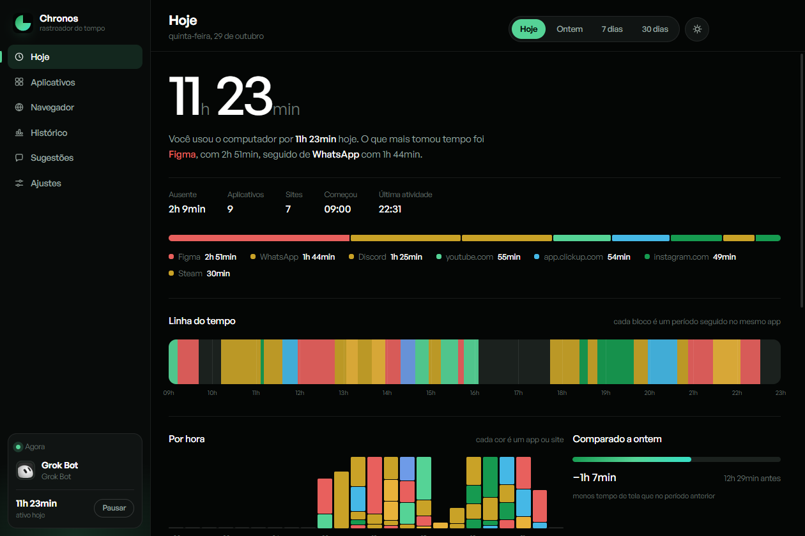

# Chronos

Rastreador de tempo para Windows. Mede quanto tempo você passou em cada
programa e, no navegador, em cada site — direto no seu computador, sem nuvem,
sem conta e sem assinatura.

**[Baixar →](https://baixar-chronos.vercel.app)**



---

## O que ele faz

- **Separa o navegador por site.** Em vez de "Google Chrome · 3h41", você vê
  `youtube.com`, `figma.com` e `app.clickup.com` cada um com o seu tempo.
- **Conta o que está sendo usado de verdade.** Se tem som saindo do programa —
  uma call, um player, um jogo — ele está em uso mesmo minimizado. Programa só
  aberto em silêncio não conta.
- **Nunca soma duas vezes.** Uma call de 40min com 10 deles também em primeiro
  plano dá 40, não 50.
- **Desenha o dia numa faixa.** Cada bloco é um período seguido no mesmo app.
- **Atualiza sozinho.** Quando sai versão nova, aparece um cartão na tela
  inicial com o que mudou.

## Privacidade

Nenhum dado de uso sai da máquina. Tudo fica em `%APPDATA%\Chronos`, num
arquivo por dia. A única coisa que é enviada para fora é o texto que você
escreve na aba Sugestões e envia de propósito.

Ele lê o endereço na barra do navegador (`youtube.com`) e o título da janela —
não o conteúdo das páginas.

## Como funciona

Um probe em C# (`native/ChronosProbe.cs`, compilado com o `csc` que já vem no
Windows) informa a cada segundo:

| o quê | de onde |
| --- | --- |
| janela em primeiro plano | `GetForegroundWindow` + `QueryFullProcessImageName` |
| tempo ocioso | `GetLastInputInfo` |
| site aberto | a barra de endereço, via UI Automation |
| o que está tocando | `GlobalSystemMediaTransportControlsSession` (SMTC) |
| quem tem áudio aberto | sessões WASAPI — a mesma fonte do Mixer de Volume |

O painel é HTML, CSS e JavaScript sem framework. A soma usa união de
intervalos (`src/intervalos.js`) para que trilhas paralelas não se somem.

## Rodando do código

```bash
npm install
npm start
```

Requer Windows 10 ou 11 e Node 18+. O probe é compilado na primeira execução.

## Publicar uma versão

```powershell
.\native\release.ps1 1.7.0 "o que mudou"
```

O script grava a versão no `package.json`, cria a release no GitHub **antes**
de compilar — sem isso o electron-builder sobe os arquivos em paralelo, cada
upload cria uma release com a mesma tag e o updater toma 404 — e então publica
o instalador.

## Estrutura

```
native/     probe em C# e script de release
src/        processo principal, tracker, store e o painel
site/       a página de download (baixar-chronos.vercel.app)
```
